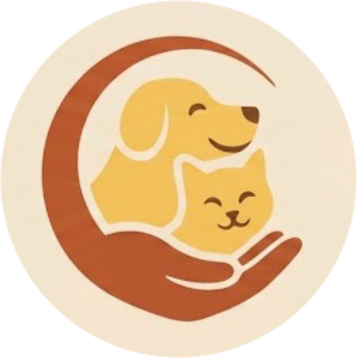

# PetHood - Presentación

**Presentación final del proyecto PetHood.**

---

Presentación del proyecto final. 20.ª Exposición Anual de Proyectos de Sistemas

UTN Regional Mendoza, Ingeniería en Sistemas de Información. Cátedra: Proyecto Final, noviembre de 2026.

## Contenido

| Archivo                                                                  | Qué es                                                                                    |
| ------------------------------------------------------------------------ | ----------------------------------------------------------------------------------------- |
| [`PetHood · Presentación final.html`](<PetHood · Presentación final.html>) | Presentación de 13 diapositivas en un solo HTML autocontenido (fuentes e imágenes embebidas) |

## Cómo usarla

Abrir el HTML en el navegador. No necesita servidor ni dependencias.

| Tecla                          | Acción                                      |
| ------------------------------ | ------------------------------------------- |
| `→` `Espacio` `Enter` `AvPág`  | Diapositiva siguiente                       |
| `←` `Retroceso` `RePág`        | Diapositiva anterior                        |
| `Inicio` / `Fin`               | Primera / última diapositiva                |
| `N`                            | Mostrar u ocultar las notas del orador      |
| `F`                            | Pantalla completa                           |
| `R`                            | Reiniciar la demo de la diapositiva actual  |

También se navega con gestos de deslizamiento en pantallas táctiles, y la URL guarda la diapositiva (`#s5` abre la quinta). Hacer clic en un teléfono reinicia su demo.

## Estructura

1. Portada
2. El problema: adoptar hoy depende de un proceso informal
3. La historia de Rocco (la adopción de punta a punta)
4. El refugio carga a Rocco y lo publica
5. Ana encuentra a Rocco
6. Pedir adopción: proceso de seis pasos
7. Chat entre Ana y el refugio
8. El refugio decide y Rocco encuentra familia
9. Seguimiento: la adopción no termina en la entrega
10. PetHood trae más
11. Herramientas para la comunidad: campañas, mascotas perdidas, reseñas y reportes
12. Panel web para refugio y administrador
13. Cierre y preguntas

Cada diapositiva lleva en `data-notes` el orador, el tiempo y el texto del guion, que se ven con `N`.

## Repos

| Repo                                                               | Qué es                                              |
| ------------------------------------------------------------------ | --------------------------------------------------- |
| [**Servidor**](https://github.com/Pethood-project/pethood-backend) | API REST, dueña de toda la lógica de negocio        |
| [**Cliente**](https://github.com/Pethood-project/pethood-frontend) | App móvil (adoptantes y refugios) + panel web-admin |

## Equipo

- Camila Fabián
- Agustín Leyes
- Nicolás Correa
- Matías Hansen
- Juan Ignacio Castro
